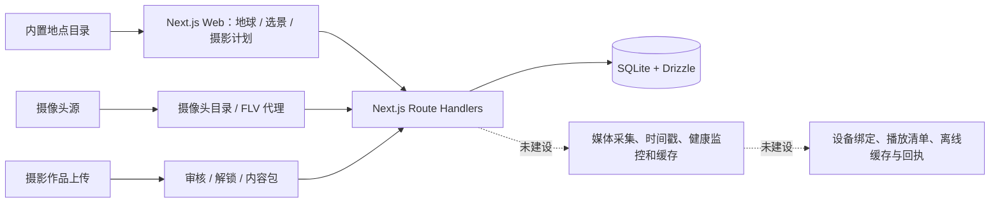

# QuasarFrame 架构、完成度与下一步方案

审阅日期：2026-10-18。依据当前工作区源码（包括尚未纳入 Git 的文件）；此文是静态审阅与计算测试结果，不等于设备、媒体源或支付联调验收。

## 产品边界与当前框架

目标产品有两条相连的路径：摄影者用可信地理信息制定拍摄计划；经授权的实景画面和摄影作品经平台分发到数字相框。当前 Web 平台原型覆盖了不少外围业务，但“采集—判新鲜度—选择内容—同步设备—确认播放”的设备链路仍未实现。

| 层 | 当前实现 | 关键边界 |
| --- | --- | --- |
| 前端 | Next.js 16 App Router、React 19、Tailwind、Cesium/Three、Zustand | 页面和客户端状态多；地点数据来自 `src/data/locations.ts` 静态目录 |
| 摄影计算 | SunCalc 2、当地时间、日月路径、视场、方向对齐、JSON/GPX 计划 | 三维地形为程序示意；计划仅浏览器 localStorage；坐标未现场核验 |
| 业务 API | `src/app/api` 的认证、作品、摄像头、线路、会员、相框商品/订单、管理端接口 | Route Handler 承担较多业务逻辑；权限和交易规则分散 |
| 数据与文件 | SQLite + Drizzle；作品图在 `public/uploads`；摄像头 URL/鉴权头在数据库 | 无设备、播放清单、观测、媒体授权和回执表；原图公开路径 |
| 媒体 | HLS/FLV/图片页面播放器，FLV 由 Next.js 代理并支持二跳解析 | 未见独立采集/转流、源健康、采集时间、新鲜度及规模分发 |
| 交付 | 本地构建和少量计算测试 | 业务代码大部分未提交；无 CI/版本化迁移/E2E/部署与恢复流程 |

## 完成度判断

这里将“完成”定义为能够用真实数据走通流程，并有可重复的验收证据。**Web 概念演示已成形；摄影辅助是可试用基础版；实时实景到实体相框的 MVP 尚未闭环；公开收费运营尚不具备条件。**不宜把页面数量或数据库表数量折算成总完成百分比。

| 工作流 | 已有 | 仍缺 | 阶段 |
| --- | --- | --- | --- |
| 地理探索 | 地球、附近、发现、11 条静态地点数据 | 精确机位/主体、坐标基准、真实地形和来源核验 | 可演示 |
| 摄影规划 | 时间、日月、视场、方向对齐、计划本地保存/导出 | 天气、路网、地形遮挡、跨设备同步和实测误差 | 可试用的基础计算 |
| 实景摄像头 | 目录、详情、HLS/FLV/图片处理；用户说明已有一个真实源 | 分发授权边界、持续播放验证、采集时间、健康监控、超时降级、媒体出口 | 接入原型 |
| 作品/权益 | 上传、审核、会员/单次解锁、内容包 | 原图私有化、统一授权、到期判定、账务事务和幂等 | 业务原型 |
| 相框 | SKU、内容包、订单与分成页面/API | 目标型号、设备身份、绑定、清单、同步、离线、心跳、播放回执 | 尚无设备产品闭环 |
| 景色订阅 | 页面及表结构 | 页面保存实际只改本地状态；无条件评估任务和通知投递 | 界面演示 |
| 工程交付 | TypeScript 检查与 10 项摄影计算测试通过 | 全量 lint 未通过，缺 CI/迁移/E2E/运行文档；主业务未纳入版本控制 | 不可复现交付 |

## 主要阻断项（按上线风险排序）

1. **交付不可复现。**Git 仅追踪 19 个初始文件，`src/app/api/`、`src/db/`、组件和测试多为未跟踪状态；根目录数据库、WAL/备份和 `public/uploads` 也未被 `.gitignore` 排除。先明确哪些是源码、哪些是数据，再安全地纳入版本控制。不要直接批量添加数据库、上传图或凭据。
2. **资金与内容权限尚有严重缺口。**订单所有者可对待支付订单调用确认付款接口，接口未校验支付渠道的真实结果；作品列表返回原图 URL/坐标，文件位于公开目录。当前不能开放真实收费和受保护原图。会员权益只看 `active` 或用户等级，未统一检查到期时间；余额、库存和分成跨多次写入，缺事务和幂等。
3. **直播入口需要收口。**普通登录用户可创建即时启用的摄像头源并声明 `official`；代理会请求用户控制的 URL 和二跳 URL，且将同一 Authorization 头用于第二跳。应限制源创建/审核、目标主机/地址/重定向、凭据作用域、超时与并发。此处是基于代码的风险判断，未进行攻击性验证。防护方案参考 [OWASP SSRF 指南](https://cheatsheetseries.owasp.org/cheatsheets/Server_Side_Request_Forgery_Prevention_Cheat_Sheet.html)。
4. **“实时”缺可验证定义。**数据库有 `isLive`，没有可信 `capturedAt`/`receivedAt`、源状态和过期阈值；页面把状态标作 LIVE，但无法证明画面新鲜。摄像头分发授权和可接受延迟仍待讨论，不应先承诺推送刷新频率或对外分发范围。
5. **相框设备模型为空。**当前只看到商品及内容包表/API，未看到 `devices`、`playlists`、`heartbeats`、`acks` 或等价实现。型号未定时可先定义能力抽象和协议，并用浏览器模拟相框验证；硬件专属播放器需待型号确定。
6. **工程质量门禁不足。**本次 `tsc --noEmit` 通过、摄影测试 10/10；`eslint src` 返回 45 个错误、53 个警告。没有发现 CI、版本化迁移或浏览器端到端测试。2026-09-29 的生产构建曾通过，本次没有重跑生产构建或真实流/设备测试。

## 开发路线与验收门槛

时间仅作排序参考，前提是约两名开发者、试点源和可编程设备可用；授权、设备选型及服务采购会改变工期。先完成前一阶段验收，再扩大范围。

| 阶段 | 参考周期 | 主要交付 | 必须通过的验收 |
| --- | --- | --- | --- |
| 0. 固化基线与风险隔离 | 1–2 周 | 源码入库、忽略/迁移运行数据、Node/构建脚本、CI；阻断模拟付款伪确认，原图私有化，收紧摄像头源及凭据；统一权益与事务方案 | 新环境可从仓库构建；lint/typecheck/build/关键权限测试通过；未付款不能获权益；原图匿名直链不可读；内网/重定向/二跳换域被拒绝 |
| 1. 一个可信实景点 | 2–3 周 | 一处授权明确的摄像头和地点；记录授权范围、坐标、朝向、采集/接收时间；快照优先、直播可选；源健康与过期降级 | 画面来源、时间和授权可追溯；断流/旧图显式降级；连续 72 小时采集日志；浏览器播放实测 |
| 2. 一台相框闭环 | 2–4 周（型号确定后校准） | 设备能力档案、配对/解绑、版本化播放清单、内容下载、离线缓存、心跳/应用及播放回执；先用浏览器模拟设备 | 未绑定设备无内容权限；切换地点后可确认清单应用和实际播放；断网/重启恢复最后有效画面；解绑吊销生效 |
| 3. 摄影工具从示意到实地 | 与 1–2 并行，但需数据许可 | 一处核验机位与主体、天气/路网、DEM 地平线；计划云端保存与误差反馈 | 与现场日月方向和遮挡对照，记录误差；服务失效/过期显示未知；计划跨设备一致 |
| 4. 小规模试点与商业化 | 基础链路稳定后 | 约 10 台试点、真实支付/退款/对账、媒体成本、监控告警、备份恢复 | 连续 7 天运行；可追踪每台同步/播放成功率与画面新鲜度；订单和分成可对账；恢复演练通过 |

设备协议建议先用 HTTPS 版本化清单和短时媒体地址，设备以独立可吊销身份获取内容，不复用浏览器会话。媒体采集、截图/转流和缓存最好从 Next.js 长连接代理拆出；HLS 可作为候选直播格式，但应在选定相框上实测播放、解码、功耗和延迟。[Apple HLS 文档](https://developer.apple.com/documentation/http-live-streaming)说明其可通过普通 HTTP 服务和 CDN 分发，并不意味着任意相框都支持。

单机试点可保留 SQLite，前提是事务、备份和文件一致性得到验证；多主机部署要重新选择数据库拓扑。[SQLite WAL 文档](https://www.sqlite.org/wal.html)说明 WAL 依赖同机共享内存，不适合不同主机共享同一数据库文件。

## 当前需要作出的产品决定

1. **先定义摄像头授权矩阵**：允许展示、缓存、转码、对外分享、相框播放和商业使用的范围，以及期限、归属和撤回方式。未确认前不新增分发路径。
2. **给出新鲜度目标**：分别定义普通快照、手动直播、断流后的最长旧图展示时长；产品同时展示采集时间和接收时间。目标由用户体验和实际源能力确定，不能由前端刷新间隔代替。
3. **圈定首个相框候选**：横/竖屏、分辨率、编码支持、浏览器或 SDK、存储、网络、远程更新与功耗。若型号尚未决定，先在浏览器设备模拟器中锁定清单/回执协议。
4. **核验首个摄影点位**：地点、机位、主体分别给出经纬度、坐标基准、精度、来源及现场照片；否则真实地形遮挡和导航误差无法验收。

评估依据包括当前源码、`tests/photography.test.ts`、`docs/local-test-2026-09-29.md`。没有运行支付写操作、数据库迁移、摄像头上游拉流或相框联调。
