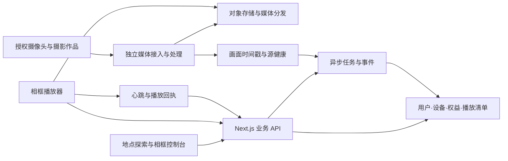

# QuasarFrame 代码评估与完善方案

审阅日期：2026-09-28。对象：当前工作区代码，包括未提交与未跟踪的业务文件。

## 1. 结论与审阅边界

项目已具备较完整的 Web 产品原型：数字地球、摄影点位、作品上传与审核、摄像头接入、会员、线路、相框商品与订单、内容包及分成。当前适合演示产品构想和验证用户需求，尚不具备公开收费运营或相框设备规模接入的条件。

最主要的产品缺口是：目前相框模块实现的是商品销售与照片内容包，没有发现设备注册、绑定、播放清单、内容同步、播放回执、心跳、离线缓存及远程更新的实现。因此“实时地理实景 → 家庭相框”的核心价值链尚未闭环。

本次进行了核心源码审阅、全局实现检索、TypeScript 和 src 范围 ESLint 检查，并核对了本地 Next.js 16.2.10 与 SunCalc 文档。未修改业务代码、未操作已有数据库、未实际下单或连接第三方摄像头。未执行生产构建、浏览器端到端测试、真实支付回调或硬件测试；以下不能视为完整安全审计或性能认证。

## 2. 当前能力评估

| 领域 | 已有基础 | 主要缺口 | 评估 |
| --- | --- | --- | --- |
| 地理探索 | Cesium 地球、静态点位、景色筛选、附近地点 | 地形与实景数据、点位数据管理、坐标体系与数据来源 | 可展示，真实选景能力不足 |
| 摄影辅助 | 焦距与方位控制、太阳/月亮计算 | 地形是程序生成；时间滑块未驱动太阳位置；黄金时段映射错误 | 示意功能，需要校正 |
| 实时画面 | HLS、FLV、图片刷新；FLV 两跳代理 | 源健康监控、统一转流、鉴权、防 SSRF、故障恢复 | 局部接入原型 |
| 作品平台 | 上传、EXIF 表单、审核、收费解锁 | 原图保护、审核状态一致性、商业使用授权 | 有业务框架，权限边界需重做 |
| 数字相框 | SKU、商城、订单、照片内容包、分成 | 实际设备与内容分发全部关键链路 | 商城原型，设备产品未落地 |
| 会员与交易 | 余额、会员、订单状态与佣金记录 | 真实支付、到期判断、事务、幂等、退款与账本 | 不能直接收费上线 |
| 景色订阅 | 页面及数据库表 | 保存 API、数据采集、条件评估任务、通知投递 | 页面演示 |
| 工程交付 | TypeScript strict、Zod、Drizzle、已有组件分层 | 测试、CI、版本化迁移、部署说明、运行环境固定 | 需要建立交付基线 |

值得保留的设计：凭据采用 bcrypt 哈希；管理员 API 大体使用 requireRole；订单详情做了所有者校验；管理员订单更新已有状态迁移约束；Cesium/Three 主体采用动态加载；数据库开启 WAL 和外键。这些基础可继续使用，无需整体推倒重写。

## 3. 关键问题及修复方案

P1 表示高优先级，修复前不应开放相关正式业务；P2 表示影响正确性、可靠性或体验的重要问题。

### R1 / P1：订单持有人可以未经支付直接确认“已支付”

证据：`src/app/api/frame/orders/[id]/route.ts:38`。POST 仅判断登录、所有者及 pending_payment，然后调用 markOrderPaid，没有验证支付结果，也没有限制为 mock 支付或开发环境。微信、支付宝待支付订单同样可以走这条路径。

影响：未实际付款即可将订单及购买记录标记为完成，触发库存扣减与分成。

方案：正式付款状态仅来自服务端验证过的支付回调或服务端主动查单；校验签名、商户、交易号、币种、金额及订单关联；开发模拟接口在生产禁用。交易号唯一，订单状态更新使用条件更新，重复回调不得重复结算。

验收：用户自行 POST 不能改变正式订单付款状态；同一有效回调重复发送只扣一次库存、产生一次分成；错误金额和签名均被拒绝。

### R2 / P1：付费照片原图与受保护参数公开

证据：`src/app/api/photos/route.ts:108` 的公开列表返回 imageUrl、GPS 与拍摄参数，没有检查购买或会员。`src/lib/file-upload.ts:6` 将原图写入 public/uploads，可通过静态 URL 获取。原图与缩略图共享 UUID，缩略图名去掉 `_thumb` 即对应原图名。

影响：详情页的字段遮蔽可以绕过，收费下载和参数解锁不成立。

方案：公开列表仅返回公开预览字段；原图存私有对象存储或非 public 目录；下载接口统一鉴权后签发短时访问地址；预览图使用独立资源标识和可选水印。作品的浏览、原图下载、相框播放和商业使用应有独立权益。

验收：匿名列表不返回私有原图与机位参数；原图直接请求被拒绝；授权地址到期失效；旧 public 原图需迁移并停止公开访问。

### R3 / P1：直播代理允许用户控制服务端请求目的地

证据：`src/lib/validators.ts:44` 只做 URL 格式校验；`src/app/api/feeds/route.ts:58` 允许普通用户创建源并立即 active；`src/app/api/feeds/[id]/stream/route.ts:99` 请求配置 URL，`:118` 请求上游 JSON 中的 URL；safeFetch 没有目标地址限制、连接超时或显式重定向策略。

影响：登录用户可将自有 FLV 源配置为服务器可达的内网地址，产生 SSRF 风险；第二跳还会复用 Authorization，目的主机改变时可能泄漏上游凭据。源实际可达范围取决于部署网络，未进行攻击性验证。

方案：只接入经过审核的源或域名；限定协议、端口，校验 DNS 解析后的 IPv4/IPv6，阻止回环、私网、链路本地等地址；每一跳和重定向都验证；凭据绑定指定源站；用网络出口策略补强。设置连接/首包超时、并发限额、取消传播和可观测日志，避免将带凭据的 URL 写入日志。

依据：[OWASP SSRF Prevention Cheat Sheet](https://cheatsheetseries.owasp.org/cheatsheets/Server_Side_Request_Forgery_Prevention_Cheat_Sheet.html)。

验收：受控测试中的私网、IPv6 回环、重定向到内网和二跳换域均被拒绝；客户端退出后上游连接被终止；令牌不会被发送到其他主机。

### R4 / P1：余额、库存、购买、解锁与分成缺乏事务和幂等

证据：`src/app/api/photos/[id]/unlock/route.ts`、`src/app/api/feeds/[id]/unlock/route.ts`、`src/app/api/subscriptions/route.ts`、`src/app/api/frame/orders/route.ts` 均存在先读取后写余额及多次独立写入。`src/lib/frame-royalty.ts:132` 分别更新订单、购买，再扣库存和写分成。schema 未定义解锁业务唯一约束。

影响：并发请求或中途失败可能导致重复权益、重复佣金、余额覆盖、扣款但未获权益。单线程同步 SQLite 驱动不保证整个含多个 await 的业务流程原子性。

库存补充：resolveOrderItems 按每条明细检查库存，同一 SKU 重复出现时没有汇总数量；库存更新以 MAX(stock - quantity, 0) 截断，无法阻止超卖。待付款期间重新读取内容包价格和分成规则，结算与下单快照可能不一致。

方案：将本地账务、库存与权益写入一个数据库事务；余额使用带余额条件的原子扣减；库存按 SKU 聚合后条件扣减或限时预占；金额用整数分；建立资金流水，退款使用冲正。解锁唯一键为 userId/resourceType/resourceId；佣金、付款事件使用业务唯一键与幂等键。订单保存单价、内容版本、作者分配和分成规则快照。

验收：并发余额支付不会负余额或覆盖扣款；重复 SKU 总量超库存时失败；事务中途失败全部回滚；重复确认不二次扣库存/生成分成；内容包后续修改不改变历史订单结算。

### R5 / P1：会员到期未参与授权判断

证据：照片解锁只查询 status=active 的订阅，未判断 expiresAt；直播详情与代理只读取 users.membership。未发现订阅到期处理任务。购买同计划时也只按 active 判断，可能阻止过期用户续订。

方案：集中 entitlement 服务，按当前时间检查 startedAt/expiresAt、权益范围、配额周期和管理员赠送权益；鉴权不依赖定时任务是否及时执行。补齐续订、升级、降级、到期和取消语义，autoRenew 在未实际支持扣款前不能暗示已实现自动续费。

验收：超过到期时间立即失去限时权益；永久购买仍有效；升级/续费不会产生冲突活跃订阅；月配额按账期计算。

### R6 / P1：生产密钥有公开兜底，管理权限可能长期陈旧

证据：`src/auth/config.ts:9` 使用固定开发密钥兜底。jwt callback 仅在登录时拷贝 role，requireRole 从 session 读取；管理员被降权后，旧会话仍可能保留权限。seed 含固定演示管理员密码与硬编码上游凭据。

方案：生产缺少 AUTH_SECRET 时启动失败；演示账号与上游凭据从生产初始化流程隔离，已使用的凭据轮换；管理操作查当前权限或验证会话权限版本，支持吊销会话；登录增加速率控制和审计。

验收：生产缺少密钥不能启动；管理员降权后旧会话不能继续调用管理 API；生产 seed 不产生固定演示管理员。

### R7 / P2：审核状态与作者权益不一致

证据：照片详情仅按 ID 查询，没有屏蔽 pending/rejected/draft；解锁也未验证 approved。付费照片作者虽然获得 isOwner=true，但没有将 isUnlocked 设为 true，仍被遮蔽。PATCH 编辑已批准作品没有重审机制。

方案：统一“公开可见、所有者可见、管理员可见、可交易”判断；作者/管理员预览独立于消费者购买权益；关键修改重新审核；解锁查询包含 resourceType；内容包只能引用允许发布且具备授权的作品。

验收：匿名不能读取未批准内容；作者可查看完整自有作品；未审核或拒绝作品不能被购买或分发。

### R8 / P2：直播协议、状态和凭据接入不完整

证据：feedCreateSchema 接受 authHeader，但创建接口未保存，更新字段列表也没有它。普通用户还能提交 type=official 且立即启用。播放器对 RTMP 渲染 video 却没有设置播放源；MJPEG 未实现专门路径。官方 FLV 在详情声明免费，但代理 requireAuth，匿名实际无法观看。详情 fetch 未先检查 response.ok，404 JSON 可能被当成 feed 渲染。远程快照经 next/image 访问，但配置只允许两个主机。

方案：官方身份由管理端决定，UGC 源先审核；源凭据仅管理后台保存并受控使用。播放器明确能力矩阵，暂只支持实测可用的 HLS/图片，其余经媒体服务转流。统一详情与媒体授权规则，提供加载、重连、离线、最后有效画面和错误状态。

补充：flv.js 在页面顶层静态导入，安装包入口直接引用 self；存在服务端预渲染兼容风险，应改为浏览器内动态导入并进行生产构建验证，本次未确认它是否已触发构建失败。

### R9 / P2：选景模拟结果与用户操作不一致

证据：`src/components/camera/CameraSimulator.tsx` 使用正弦噪声生成地形，而非真实 DEM/实景模型；timeOfDay 参数没有用于时间计算。点位页 selectedDate 固定为初始化日期，滑块只更改独立的 timeOfDay。`src/lib/astronomy.ts:32` 将晚间 goldenHour 用作早晨起点，将早晨 goldenHourEnd 用作晚间起点；本地 SunCalc README 明确这两个字段的含义与此相反。

方案：将地点时区、选定日期和滑块时间合并成单一计算时刻；晨间与晚间黄金时段分别映射并注明定义；先提供可信太阳路径与焦距视场，再逐步加入真实地形及遮挡。异步初始化后同步相机/太阳状态，清理几何体与材质资源。

补充：useCesium.flyTo 在有效调用之前传了 destination=undefined，使用时可能提前抛错；当前未发现外部调用，因此是待使用 API 的潜在问题，不等同于已证实主界面故障。Cesium 持续渲染与 Three 动画应在不可见/静止时降频或暂停。

### R10 / P2：景色订阅保存与实时条件仍是演示

证据：`src/app/subscribe/page.tsx:48` 只设置本地状态并提示保存成功，没有持久化请求；scenerySubscriptions 和 conditionEvaluations 仅有定义，没有相关运行链路。`src/lib/conditions.ts` 明确是确定性伪随机模拟，不能视为真实天气或校准过的景观概率。

方案：页面在真实保存成功后才提示；先用少量真实数据接入点位天气和画面新鲜度，标记来源与观测时间；后台评估条件并生成去重事件，再进行站内通知和相框清单更新。模拟结果必须显式标注，暂不输出未经校准的概率承诺。

### R11 / P2：图片元数据与运行数据管理

证据：原图和预览均调用 withMetadata，与“去除 EXIF”的注释不一致；缩略图输出 JPEG，却沿用输入 .png/.webp 扩展名。经纬度等用 `value || null`，会丢失合法的 0 值。上传读取完整 formData 后才检查大小。仓库根目录的数据库、WAL/SHM、备份和 public/uploads 当前未被 .gitignore 排除。

方案：公开预览去掉 EXIF/GPS；确需保留的私有元数据单独存储并设置公开精度；用 `??` 处理数值；输出格式与扩展名一致。网关限制请求体、服务端限制像素和处理并发；失败时清理孤立资源；忽略运行文件并建立一致性备份和恢复验证。

## 4. 建议产品路线与架构

### 4.1 MVP 聚焦

建议首版聚焦“选一个真实地点，让相框持续显示该地点的新鲜画面”，以实景快照为默认，直播为可选模式，收藏摄影作品为离线与故障降级。旅游线路、广告和复杂分成留在基础链路稳定后推进。

试点建议：3–5 个稳定且有分发授权的摄像头点位、一个目标设备型号、约 10 台试点设备。设备形态与现有厂家接口仍待确认；不要假定已有任意相框能安装播放器或提供设备 SDK。

### 4.2 模块关系

保留 Next.js 作为 Web 与业务 API，业务逻辑从 Route Handler 提取到权限、订单、设备、内容服务。流媒体长连接、转码和截图放到独立媒体进程，避免每台相框都经 Next.js 拉一条上游直播。

快照优先进入对象存储，由分发层缓存；直播按设备能力统一输出 HLS，可减少协议分叉。HLS 是基于 HTTP 的直播/点播技术，适合常规 HTTP 分发；最终支持情况需在目标相框上实测。[Apple HLS 文档](https://developer.apple.com/streaming/)

单机试点可保留 SQLite，但要修事务、索引、迁移和备份。多实例业务服务应采用适合该拓扑的数据库，例如 PostgreSQL；不能把 SQLite WAL 文件直接共享给不同主机。[SQLite WAL 限制](https://www.sqlite.org/wal.html)

### 4.3 新增最小数据模型

| 模型 | 用途与关键字段 |
| --- | --- |
| locations / capture_positions | 地点、采集点、坐标体系、时区、数据来源 |
| media_assets / feed_observations | 原图/预览、拍摄时间、采集时间、校验和、来源、健康状态 |
| licenses / entitlements | 观看、下载、相框播放、商业使用权限与有效期 |
| devices / device_bindings | 设备身份、型号、能力、所有者、令牌版本、解绑状态 |
| playlists / playlist_items | 内容、排序、时长、适配、清单版本和生效时间 |
| device_syncs / playback_events | 下发、下载、应用、正在播放的版本与失败原因 |
| payment_events / ledger_entries | 支付证据、资金流水、退款和幂等关联 |

### 4.4 设备协议与播放器

先采用 HTTPS 拉取版本化播放清单，服务端用 ETag/版本号避免重复下载；MVP 无需立即引入消息代理。需要秒级远程命令或设备数量增长后，再评估 MQTT/WebSocket。

建议接口：

- `POST /api/device-pairings`：创建短时配对申请；用户登录确认后绑定设备。
- `GET /api/devices/:id/manifest`：设备专属清单、内容短时 URL、播放策略、版本与有效期。
- `POST /api/devices/:id/heartbeat`：设备状态、客户端版本、当前清单版本与媒体健康。
- `POST /api/devices/:id/acks`：下载/应用/播放确认，携带事件 ID 以便去重。
- 控制台提供切换地点、收藏、播放计划、休眠、解绑和清单同步状态。

设备用独立可吊销令牌，不复用用户浏览器 Cookie。下载后校验文件并原子切换清单，重启可恢复最后有效版本；断网展示缓存照片，画面过期时显示采集时间或自动降级，不能继续显示“实时”。

绑定、下发成功与播放成功是三种状态，控制台必须分别展示；“推送成功”以设备应用或播放回执为准。

### 4.5 实时性与费用策略

每张快照记录 capturedAt、receivedAt、sourceId、checksum、授权和可用状态；重复刷新同一旧图片不算新鲜画面。源缺少可信采集时间时，应显示“接收时间”，不伪装为拍摄时间。

建议默认 30–60 秒更新实景快照，手动进入直播。目标是新鲜、有变化、可长期展示，不必追求监控级秒级延迟。静态画面支持轻微平移、裁切和横竖屏布局，尊重构图并允许用户调整。

费用示例仅用于量级判断：假设全天 2 Mbps 直播，每设备每天约 21.6 GB（十进制，不含协议开销）；100 台约 2.16 TB/天。若快照每张 200 KB、每分钟一张，约 0.288 GB/设备/天。实际费用需根据内容尺寸、缓存命中、观看时长和供应商计价评估。

## 5. 完善计划

下列为已有设备可编程、试点源可用、约 2 名开发者投入时的初步排期；硬件适配、源采购和授权会改变工期。每阶段以验收通过为完成条件。

| 阶段 | 参考周期 | 主要交付 | 验收标准 |
| --- | --- | --- | --- |
| A：安全与交付基线 | 1–2 周 | 修 R1–R7；生产禁模拟支付；原图私有化；Node 固定；核心回归测试与 CI | 无权限/付款绕过；并发事务与回调幂等测试通过；lint/typecheck/build 通过 |
| B：真实实景接入 | 2 周 | 3–5 源；转流/截图；健康监控；真实时间戳；统一播放器 | 源故障可观测并降级；浏览器兼容实测；连续运行 72 小时 |
| C：相框核心闭环 | 2–3 周 | 一个设备型号；配对；清单同步；缓存；回执；控制台 | 未绑定设备无访问；换地点可应用；断网与重启能恢复；解绑即时撤销 |
| D：试点与运营 | 2–3 周 | 约 10 台试点；真实支付与退款；备份恢复；告警；费用仪表 | 连续 7 天运行；同步/播放成功可追踪；订单、账务与分成可对账 |
| E：增强能力 | 试点后 | 真实地形选景、景色事件订阅、更多型号、创作者供给与分成 | 用实际需求与成本决定范围，不影响核心播放稳定性 |

建议正式试点门槛（目标值，尚未测得）：在线设备清单应用成功率 ≥99%；在定义的测试网络下切换内容 p95 ≤30 秒；快照新鲜度按源 SLA 达标；断网缓存可持续展示；支付、库存、权益、分成无重复记账；任何展示都可追溯来源和采集/接收时间。

建议优先补充的测试：付款伪造与重复回调、匿名原图访问、审核状态、过期权益、管理员降权、SSR​​F 一跳/二跳/重定向、并发余额扣减、重复 SKU 库存、退款冲正、设备跨账户访问、掉线重连与清单恢复。重点测试业务边界，不为简单 UI 样式编写机械测试。

## 6. 本次检查结果与工程补强

- 当前默认 Node 为 v9.4.0，直接运行 npm lint 与 tsc 会在工具启动阶段语法失败；安装的 Next.js 要求 Node >=20.9.0。
- 使用环境提供的 Node v24.19.0 重新运行 `tsc --noEmit --incremental false`，退出码 0。
- 使用同一运行时对 src 执行 ESLint：122 个扫描文件，50 个错误、61 个警告；45 个错误为 no-explicit-any，5 个错误为 set-state-in-effect。另有未使用变量、图片与 Hook 依赖等警告。此结果不代表默认 lint 脚本扫描全仓库的总数。
- 未发现项目自身测试文件、CI 工作流或版本化迁移文件；package.json 没有测试脚本。README 仍为框架初始化模板。
- 建议固定 Node 版本与包管理器，建立环境变量示例；Cesium 静态资源复制脚本应失败可见，不使用 `true` 隐藏错误；第三方复制资源从源码 lint 范围排除。
- 为高频过滤字段、外键及业务唯一键增加索引/约束；线路和内容包 JSON 关系逐步规范化；时间统一存 UTC，地点时区用于展示与日照计算。
- 当前工作区有大量未提交和未跟踪业务文件，建议在整理运行数据与凭据后形成可复现源码版本，再推进修复，避免丢失现有成果。

## 7. 立项时仍需明确的约束

1. 相框是现有厂家设备、自研 Android/Linux 设备，还是 Web 播放屏？是否允许安装播放器与远程更新？
2. “实时”优先指连续视频、周期快照，还是景观事件出现时更新？可接受延迟与默认播放模式是什么？
3. 摄像头来源是否允许二次分发和家庭相框播放，照片授权是否覆盖内容包及商业使用？
4. 第一阶段的设备数量、每日播放时长、分辨率和流量预算是什么？

在这些约束明确前，可立即推进 A 阶段与设备无关的媒体/权益抽象；真实设备适配和容量承诺应在确认目标硬件后完成。
