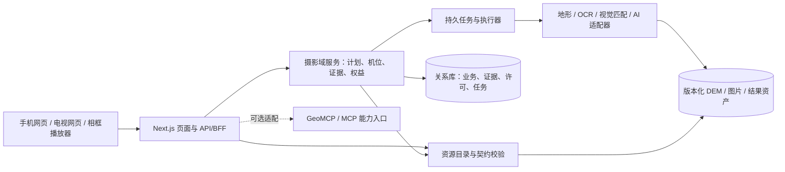

# QuasarFrame 地理能力重构调整方案

日期：2026-10-22。状态：分阶段实施中；R0/R1 的首个资源卡代码包已于 2026-10-23 完成，其余阶段仍为方案。目标是把现有摄影助手与实景内容服务改造成**可追溯、可扩展、可授权分发**的平台，同时保留用户已经能使用的选景、拍摄计划、照片分析和地形试点。产品同时面向摄影用户与创作者/能力提供方：前者获得从选景到出片的服务，后者提供内容、机位和处理能力并获得交易或订阅收入；手机、电视和数字相框是内容交付终端。

## 1. 参考对象与取舍

这里的 GeoCard、GeoMCP 指 [GeoNexus-SDK](https://github.com/GeoNexus-Team/GeoNexus-SDK) 内的资源契约与调用协议；若指的是其他同名项目，应在实施前改正映射。参考对象及本项目的采用范围：

| 参考 | 值得借鉴 | QuasarFrame 的具体用法 | 暂不采用 |
| --- | --- | --- | --- |
| [GeoCard / GeoNexus-SDK](https://github.com/GeoNexus-Team/GeoNexus-SDK) | 资源有机器可读身份、空间/时间范围、坐标系、输入输出契约；请求前做契约校验 | 给 DEM、机位照片、固定相机、分析能力、AI 模型建立版本化 `ResourceCard`；先用 TypeScript/Zod 校验，导出 JSON Schema | 为所有页面和用户资料机械套用完整 GeoCard 字段，或立即引入 Python SDK 作为主业务框架 |
| [GeoMCP / GeoNexus-SDK](https://github.com/GeoNexus-Team/GeoNexus-SDK) | 能力发现、描述、执行、健康检查的统一边界；与官方 MCP 桥接分离 | 先在服务端建立 `capabilities / describe / execute / health` 的内部能力接口；稳定后再做可选 GeoMCP/MCP 适配器 | 将浏览器业务 API 直接换成 JSON-RPC，或让外部 Agent 绕过用户授权调用私有资源 |
| [GeoNexus-Platform](https://github.com/muyang/GeoNexus-Platform) | 管理/审核/审计与计算执行分工；门户通过 BFF 聚合，不把目录回退伪装成权威数据 | Next.js 继续承担网页与 BFF；管理后台治理资源和许可；耗时栅格/图像处理移至独立 worker；目录标出来源与降级 | 照搬 Java + Node + Python 三套服务和身份系统，或提前建设联邦节点网络 |
| [GeoKG](https://github.com/muyang/GeoKG) | 领域内容和通用图能力分离；实体必须有来源、许可、检索日期、版本、有效性 | 为地点、机位、照片、主体、观测、数据集建立可查询关系与证据链；先用现有关系库表和索引 | 导入其 SDG/卫星数据、以实体数量为目标，或在查询场景尚未证明前部署图数据库 |

**复用原则。** 第一轮复用设计和测试用例思路，不复制外部实现。SDK 和 Platform README 标明 Apache-2.0，若后续确需引入代码，应固定版本、保留许可与 NOTICE、单独核对依赖；GeoKG 仓库根目录当前公开列表未显示明确许可证，查清代码及数据许可之前仅作设计参考。开放 DEM、第三方影像、摄影作品和摄像头画面的分发许可分别核对，不能因框架代码开放而推定数据可商用。

实施前重点阅读的参考代码为 SDK 的 `schemas/geocard.schema.json`、`src/geonexus/geocard/`、`src/geonexus/geomcp/`、`src/geonexus/geotask/`；Platform 的 `lib/sdk-client.js`、`geonexus-execution-plane/src/geonexus_execution_plane/` 和治理/审计实现；GeoKG 的 `src/geokg/sources.py`、`docs/provenance-audit.md`。先固定各仓库的具体提交，再做字段映射和许可核验，避免把 README 中的功能描述当成已验证的 QuasarFrame 兼容代码。

## 2. 现状与目标差距

当前仓库使用 Next.js 16 / React 19、Drizzle + SQLite。`src/db/schema.ts` 已有 `places`、`vantage_points`、`subjects`、`shooting_plans`、`photos`、`camera_feeds` 等业务表。牛背山离线 DEM 通过 `src/server/terrain.ts` 加载，`src/server/terrain-analysis.ts` 计算剖面、地平线和日月遮挡；`src/lib/skyline-match.ts` 给出限定区域的低可信度机位候选。`src/server/photo-evidence.ts` 和 `src/lib/photo-evidence.ts` 读取 EXIF 与来源，`POST /api/photos/analyze` 当前明确返回 `exif_only` 和 `visualGeolocation: not_run`。公开摄像头分发由 `AUTHORIZED_FEED_IDS` 默认关闭。已有摄影相关测试位于 `tests/`。

这些基础能力应保留。主要差距是：

1. DEM 有单独的元数据与校验值，照片有字段级来源，但地点、机位、相机、模型、分析结果尚无**统一可查询的来源/许可/时效契约**。`places.status` 仍只有 `illustrative`；`shooting_plans.dataVersion` 是文本，难以追到完整输入快照。
2. 地形只识别 `niubei`，当前数据读取和计算耦合于该单点；扩展到多个机位及不同 DEM 时缺少选择、覆盖范围与质量门禁。
3. EXIF 和山脊匹配是同步调用。未来 OCR、地物检索、ControlNet 概念模拟、视频帧处理需要持久任务、限额、取消、重试和结果审计，不能依靠一次网页请求完成。
4. `camera_feeds` 有流地址与开关，但缺源级授权范围、采集时间/接收时间、过期阈值、撤权记录和不同终端的分发约束。这些仍取决于源方授权与产品决定。
5. 现有照片来源只区分 EXIF/人工/未知；照片视觉候选、参考数据源、证据冲突、置信度校准与人工核验尚未形成完整记录。用户尚未提供现场真值照片，精度不可声称达标。

## 3. 目标结构

- **Web/BFF**：保留 Next.js App Router 和现有页面路径。Route Handler 负责鉴权、参数解析、调用与响应；复杂规则收敛到 `src/server/`。后续写代码前按仓库 `node_modules/next/dist/docs/` 的相应指南核对 Next 16 行为。
- **领域核心**：摄影计划、机位与主体、照片证据、地形分析、内容许可、订阅权益分别维护清晰服务边界。纯几何与证据评分函数继续留在 `src/lib/`。
- **资源目录**：为可计算、可分发资源登记卡片与状态；目录是来源说明和适配器选择入口，不替代用户照片/订单等业务表。每张卡片必须声明 `owner`、`kind`、`version`、`status`、`spatial`、`temporal`、`quality`、`provenance`、`rights` 与输入输出契约；不适用字段应显式为空并有原因。
- **计算执行**：短时确定性计算可继续在 Node 服务内；栅格预处理、视觉定位和 AIGC 通过持久任务在独立进程运行。Python 只在 Rasterio、CV 或模型库确有收益时加入，并通过版本化 HTTP/任务协议与 TypeScript 核心通信。
- **知识关系**：先建立有类型的边与证据记录，使用 SQLite 查询地点—机位—主体—照片—观测—数据集之间的关系；只有跨区域复杂图检索出现性能或表达问题时再评估 PostGIS/图数据库。照片原图和精确私有机位不进入公开图查询。

## 4. 分阶段实施与验收

以牛背山为首个纵向试点，使用一个真实 DEM、一个私有拍摄计划和一张测试照片贯穿改造。每阶段用小迁移和兼容适配承接现有 API，完成后再切下一段。工期是 1–2 名熟悉代码的开发者的粗估，不含现场采样和授权谈判。

| 阶段 | 具体改动 | 可交付验收 | 粗估 |
| --- | --- | --- | --- |
| **R0：锁定基线与契约** | 盘点 `src/app/api/**`、`src/server/**` 和 `src/db/schema.ts`；记录现有响应快照、数据库备份/迁移演练、私有机位与公开资源边界。定义 `ResourceCard v1` 和 `AnalysisResult v1` 的 TS/Zod/JSON Schema；列出必填、缺失与版本升级规则。 | 现有功能与权限测试、lint、typecheck、build 均可复现；牛背山 DEM、示意地点、现有相机各有草稿卡，能明确区分“真实数据”“位置未核验”“禁止公开分发”。 | 3–5 天 |
| **R1：资源目录与来源治理** | 新增 `resource_cards`、`resource_versions`、`source_licenses`（或同等关系表）及迁移；将 `terrain-data/niubei/metadata.json` 映射为 DEM 卡，将地点目录/相机源/照片资产逐步登记。增加目录查询与契约校验服务；管理页面显示来源、许可、覆盖范围、更新/核验时间、失效状态。 | 不符合坐标基准、覆盖、时效、许可的资源不会被选入分析或播放；旧页面仍可工作，降级内容明显标为示意/未知。所有公开资源可查来源和版本。 | 1–2 周 |
| **R2：任务化分析与多 DEM** | 新增 `analysis_jobs`、`job_events`、`analysis_artifacts`，状态 `queued/running/succeeded/failed/cancelled`，输入指纹、资源版本、操作者、尝试次数、错误类别和输出位置；把现有山脊候选纳入任务框架，为后续照片视觉候选与 AI 概念模拟提供异步入口，再将多 DEM 选择做成适配器。地形即时剖面保留同步接口。 | 重复提交同输入不重复收费/计算；进程重启后任务可对账；超时、取消、源数据消失有明确状态；结果可追溯到 DEM、模型、参数和运行版本。牛背山之外无 DEM 时明确拒绝真实分析。 | 2–3 周 |
| **R3：摄影证据关系与指导** | 新增 `evidence_items`、`location_candidates`、`entity_relations`（或领域专用关联表），接入照片 EXIF、人工标点、山脊评分；视觉 OCR/地物/参考影像作为可插拔证据源，先只在获得许可的数据集与用户主动触发的任务上运行。界面展示证据支持/反驳、候选误差、来源、人工确认。 | 无 GPS 照片只给带半径与低可信度说明的候选；单一模型输出不能自动写成实测坐标；撤销照片分享会阻断关联公开查询。用 5–10 张真实真值照片评估候选前 5 命中率、位置/方位误差，未达门槛保持实验标签。 | 2–4 周，现场验收另计 |
| **R4：授权观测与多屏资源** | 用 `source_licenses` 约束相机/移动投稿的展示、缓存、转码、收费、终端和撤权；新增 `observations` 的 `capturedAt/receivedAt`、质量与新鲜度，频道与播放清单只选择有效资源。手机/电视共用后端，硬件相框先以浏览器能力档案模拟。 | 未授权源继续无法公开；撤权后不再下发新清单；过期画面明确标识；分发延迟按获批的源级阈值判定。型号未定不影响软件协议试点。 | 2–4 周，授权确认后上线 |
| **R5：创作者与终端交易闭环** | 在现有作品、会员、订单与分成表基础上，区分内容许可、能力调用许可和终端播放权益；增加创作者上架审核、价格/分成版本、使用计量、退款/撤权、设备绑定与播放清单。先做授权作品或频道订阅的单一试点，能力市场采用邀约制。 | 订单、权益、播放/调用和结算可追溯；撤权停止新交付；重复支付事件不重复发权或分成；手机与电视使用相同权益判断。真实支付与相框出货须通过单独上线门槛。 | 2–4 周，授权与支付核验后上线 |
| **R6：对外能力适配** | 从已经稳定的内部能力接口映射 `capabilities/describe/execute/health`；如有真实第三方 Agent 或 GIS 合作方，再实现 GeoMCP/MCP、STAC/OGC 适配。为每个能力加身份、范围、配额、审计、私有坐标脱敏。 | 外部客户端只能发现被授权的能力；同一输入在网页与适配器得到同版本结果；未授权调用被拒并留痕；关停适配器不影响核心网页。 | 1–2 周，按合作需求启动 |

R1/R2 是重构主干；R3 的真实照片验证与 R4 的源授权可并行准备，但不能用模拟样本替代上线验收。R5 的交易系统只在授权、支付和结算规则明确后公开；R6 不作为摄影助手首发依赖。

## 5. 首批代码落点与迁移方式

建议在实施时把设计收敛为以下边界；这是**拟议路径**，并非现存文件：

| 现有代码 | 下一步位置或处理 |
| --- | --- |
| `src/server/terrain.ts`、`scripts/terrain/build_niubei.py` | 保持采样/离线构建分工；增加 `src/server/resources/terrain-provider.ts` 和 DEM 卡片校验，逐步去掉 `locationId === 'niubei'` 特例。历史 DEM 元数据保留并登记版本、哈希和许可。 |
| `src/server/terrain-analysis.ts`、`src/lib/geo.ts` | 纯计算保持；入口接受已校验的机位、DEM 卡与时间上下文，统一输出 `status + uncertainty + provenance`，拒绝高程基准不匹配。 |
| `src/server/photo-evidence.ts`、`src/lib/photo-evidence.ts`、`src/lib/skyline-match.ts` | EXIF 与匹配算法保持；增加证据记录/候选持久化和任务入口，照片视觉判断不覆盖 EXIF 或人工声明。 |
| `src/db/schema.ts` 中 `camera_feeds`、`photos`、`shooting_plans` | 采用新增表与外键逐步关联，不一次性重写旧表；对历史行回填 `unknown/unverified`，绝不自动标为有授权或已核验。 |
| `src/app/api/**` | URL 和成功响应先保持兼容；新增字段采用加法，前端切换后再弃用旧字段。管理端更新资源状态需审计，公开端只读获准版本。 |

迁移顺序：**备份现有 SQLite → 新表与索引 → 只读回填/比对报告 → 双读验证 → 新写入 → 移除旧读取**。每步留回滚方式和版本号；原照片、DEM、相机凭据不放进数据库迁移或 Git。若试点由 SQLite 转向 PostgreSQL/PostGIS，应在 R2 后根据并发、空间查询和部署规模的实测结果决定，而非作为 R0 前置。

## 6. 必须写进契约的可信度与权限

- **空间**：WGS84 经纬度、水平精度、海拔基准、观测姿态、覆盖 bbox；`WGS84-assumed` 与 `verified` 分开，未知精度不写成 0。国内底图如使用其他坐标基准必须显式转换。
- **时间**：采集/上传/接收/分析/核验时间分开；照片相机本地时间没有时区时不得强转 UTC；相机新鲜度阈值按源配置，目前暂不填运营值。
- **结果**：确定性地形计算与 AI 概念模拟分别存储；概念图标明模型、输入、DEM 版本及生成时间，不冒充实拍或天气预测。
- **来源与许可**：每个外部数据源有原始链接、获取日期、版本/哈希、署名要求、可展示/缓存/衍生/收费/跨屏范围与失效状态。证据缺失时 `UNVERIFIED`，禁止静默晋级。
- **隐私**：照片原图和精确机位默认私有；公开知识关系使用脱敏位置或公开授权版本；订阅权益和来源许可是两道独立门禁。

## 7. 决策点与实施优先级

**现在即可开始**：R0 契约与基线、R1 的 DEM/地点来源登记、R2 任务模型设计。首个可审查的代码包应只覆盖“牛背山 DEM 卡片 + 地形分析契约校验 + 兼容 API + 测试”，避免同时迁移照片、相机与前端。

**需要外部输入才能上线**：现场核验机位与原始对照照片（地形/视觉定位精度），固定相机的二次分发授权范围，源级可接受更新延迟，AI 模型与参考图商业使用范围。相框型号未定时继续按浏览器/电视能力抽象开发。

实施后的关键指标：有效资源卡来源覆盖率、契约拒绝原因、DEM 覆盖与无数据率、实测山脊角度误差、候选位置/方位误差、任务成功率与 P95 耗时、相机画面年龄/撤权生效时间、私有位置泄露与越权用例。指标阈值需结合现场样本和授权条款确定；没有真值之前只记录，不宣称定位精度。

## 8. 协议与 Card 如何连接摄影能力

QuasarFrame 不直接把所有上游包装成公开 GeoMCP 服务。内部先建一个**能力目录 + 调用网关**，用 `Card` 描述资源，用适配器处理不同协议，用统一结果记录证据与权限。GeoCard 负责语义和约束；已有服务继续使用 HTTP/文件/对象存储，未来有外部 Agent 需求时才开放 GeoMCP/MCP。地理资产交换优先兼容 [STAC](https://stacspec.org/en/about/stac-spec) 的资产与时空链接，以及 [OGC API](https://ogcapi.ogc.org/) 的地图、要素、环境数据、过程能力；不要求每个上游原生支持这些标准。

| Card 类别 | 例子 | 必须核验的字段 | 首个调用/使用场景 |
| --- | --- | --- | --- |
| `DataCard` | DEM、地图图层、地点目录、气象预报、天文历表 | 区域/时间覆盖、CRS/高程基准、分辨率、更新时间、来源、许可与缓存条件 | 牛背山 DEM + 日月轨迹；后续天气/路网适配器 |
| `MediaCard` | 用户照片、参考图、固定相机快照、移动机位投稿、音乐或视频 | 作者/权属、拍摄/接收时间、位置公开精度、展示/加工/收费/跨屏许可、撤回状态 | 照片证据与获授权实景频道 |
| `CapabilityCard` | 地平线、视场、构图评分、曝光建议、滤镜、色彩匹配/追色、OCR、背景分割 | 输入输出模式、版本、耗时/费用、适用色域或传感器、失败模式、样本质量、隐私边界 | `terrain.horizon.v1`、`photo.exif.v1` 两个内建能力 |
| `ModelCard` | 山脊识别、多模态场景分析、ControlNet 概念模拟 | 模型/权重版本、推理端点、输入许可、生成内容标识、评测数据、单次成本 | 先登记但不开启自动执行 |
| `WorkflowCard` | 选景→算光线→构图→方案；上传照片→取证→候选→指导；作品→审核→频道 | 步骤依赖、人工确认点、输入/输出版本、取消/重试、权益门禁 | 摄影助手闭环 |

每张 Card 至少包含 `id`、`kind`、`version`、`provider`、`contract`、`coverage`、`provenance`、`rights`、`quality`、`availability`、`cost` 和 `status`。例如气象能力的 `coverage` 必须同时包含地域与预报有效时间；滤镜能力的 `contract` 必须写明色彩空间、位深、导出格式以及可否对用户原图持久存储。`cost` 区分上游成本与面向用户价格。Card 指向受控资源或适配器，**不存相机密钥、用户私有坐标或付费素材的公开直链**。

请求链路固定为：`discover → validate(时空/格式/精度) → authorize(用户权益+源许可) → reserve(额度/预算) → execute(同步或任务) → record(来源、版本、费用、误差) → deliver`。资源不可用时返回明确的缺口和可替代卡，不将示意、过期预报或 AI 生成图自动替代真实观测。对用户而言，助手可以给出“本地点无可用 DEM，所以只能查看地图和日月几何”的解释，而不是静默生成可信度不足的构图结论。

首批适配器按收益排序：现有 DEM 和天文计算 → 照片元数据与山脊匹配 → 获授权的地图/天气源 → 滤镜与色彩匹配 → 视觉模型与 AIGC。上游地图和气象的具体供应商待覆盖范围、接口条款、单位成本与本地部署方式比选后确定；先定义协议，不把某一家 API 写死在产品模型中。

## 9. 摄影知识图谱：知识、证据和建议分层

知识图谱服务摄影决策与人文咨询，而不是追求大量节点。建议先定义以下领域本体，并用关系表及来源表落地：

| 实体 | 关键关系与用途 |
| --- | --- |
| 地点、机位、主体、视线、拍摄时段 | `位于`、`可见`、`朝向`、`受地形遮挡`、`适合时段`；用于构图和日月方位问答 |
| 摄影风格/流派、作品、摄影师、时代 | `体现风格`、`受影响于`、`使用技法`；用于理解风格而非把主观审美当成客观真值 |
| 色彩方案、滤镜、追色参考、相机/镜头 | `适用场景`、`目标色彩`、`需要校准`、`兼容设备`；连接建议与可执行处理能力 |
| 构图法、光线/布光方案、妆容、服装、场景 | `适合题材`、`依赖光位`、`与妆容协调`、`可能冲突`；用于人像/风光/夜景等任务规划 |
| 地理地物、交通、安全提示、历史事件、文化遗产、地方习俗 | `位于`、`发生于`、`关联人物`、`访问限制`；用于拍摄地点解释和负责任的出行建议 |
| 证据、数据源、许可、观测、模型运行 | `支持`、`反驳`、`来源于`、`有效至`、`允许使用`；让每条回答可追溯 |

事实节点与关系保留 `source_url/source_id`、引用范围、许可、采集/核验日期、空间与时间有效范围、置信度、审核人和版本。另设 `claim_type=fact|observation|inference|recommendation`：历史人文事实要求可追溯来源，天气是有有效期的观测或预测，风格和美学建议是带解释的推荐。用户照片的 EXIF 只是证据，不自动证明作者、地点或风格；图像模型识别结果为推断，待人工确认。矛盾来源要并存并显示差异，不覆盖旧证据。

摄影咨询使用 `问题 → 解析地点/题材/时间 → 按权限检索图谱和资源卡 → 执行需要的能力 → 汇总带来源的答案`。示例：“周六在牛背山拍日出云海，用 70–200mm 镜头，想要冷暖对比的电影感”可返回可用机位与朝向、地形遮挡、日出时间、天气时效、可参考的色彩方案及一个**可选**概念模拟任务；每项答案列出依据、误差和未知项。历史人文咨询优先引用可核验资料，缺出处时直接提示尚未核实。早期用关系查询与全文检索；只有真实问答表明跨域关系检索必要时再引入图引擎或图谱 RAG。

## 10. 双侧平台服务与端到端闭环

**摄影用户侧**以任务为入口：找地点/灵感 → 核验机位与光线 → 规划镜头、构图、布光与妆造 → 现场对照/上传照片 → 取证与指导 → 选滤镜/追色 → 发布作品或订阅实景频道。每一步使用 Card 选能力、KG 给背景与解释；助手保留人工修改和不确定性展示。

**供给与交易侧**分三类：摄影师提供作品、路线、参考色彩或授权机位；机构/开发者提供地图、气象、图像处理或摄影教学能力；固定相机方提供实时观测。上架流程为 `提交权属与许可 → 卡片校验 → 人工/自动审核 → 定价/分成版本 → 试运行与质量监测 → 发布/暂停/撤权`。平台可售卖单次能力调用、作品授权、创作者频道、摄影助手会员与终端订阅，但每种商品的权利与交付单位必须独立，避免把“购买作品”误当成可跨屏连续播放或二次训练许可。

**交付终端**共用内容清单与权益服务：手机提供完整规划与创作；电视偏向频道浏览、遥控与大屏显示；数字艺术相框偏向定时更新、离线缓存和远程管理。相框硬件型号未定，先在电视/浏览器模拟器验证清单、分辨率、码率、更新频率和断网恢复，再定 SKU。既有 `photos`、`camera_feeds`、`purchases`、`commissions`、`user_subscriptions`、`frame_content_bundles` 可作为迁移起点，但真正收费前还需核对支付回调、退款、税务与结算、版权凭证、撤权和内容审核。

商业试点建议只选**一项服务 + 一项供给**：免费摄影规划结合一个经现场验证的牛背山机位；随后测试一组明确授权的创作者作品/实景快照订阅。先测用户是否理解建议依据、是否愿意按计划出行、内容观看时长和创作者结算准确性，再决定开放能力市场或硬件销售。避免在许可、数据精度和服务质量未验证时同时推广多种付费产品。

## 11. 下一份可执行代码包

建议首个代码包限制在 R0/R1：`ResourceCard v1` 合约与验证器、牛背山 DEM 和现有天文计算的样例 Card、目录只读 API、地形分析前契约检查、来源/版本响应字段、鉴权与无数据/基准不符测试。它应在不更改现有拍摄计划 URL 和页面主要流程的条件下合并。完成后用这个样板定义照片、天气、滤镜与创作者资源卡；KG 与交易不会抢在来源和权限底座之前上线。

**实施记录（2026-10-23）。** 上述首包已落地：`ResourceCard v1` 的 Zod 契约与 JSON Schema、牛背山 DEM 和 SunCalc 样例卡、只读目录 API、地形分析前的覆盖范围/坐标基准/操作校验，以及分析结果中的卡片 ID、版本、来源、署名和校验值。公开目录仅列出已安装且通过读取校验的 DEM；原图和私有机位未进入目录。完成 29 项自动测试、类型检查与生产构建。后续 R1 仍需持久化资源/许可版本、补上相机与照片的授权治理和管理审核；真实机位与照片未提供前，DEM 精度继续标为未核验。

**第二批实施记录（2026-10-23）。** 照片 MediaCard、EXIF/人工证据与限定区域山脊候选已接入私有记录；新增来源许可版本、管理员审核、撤权和受控原图/缩略图；知识关系有带来源的编辑建议种子与查询；已有余额购买可产生分终端权益，相框清单在读取时重新检查许可。迁移及未完成的外部依赖见 [摄影证据、知识关系与授权交付试点](platform-evidence-knowledge-entitlements.md)。这些实现是 R1/R3/R5 的软件纵向切片，不能将未授权摄像头、真实视觉定位、历史人文事实库或外部支付标记为完成。
