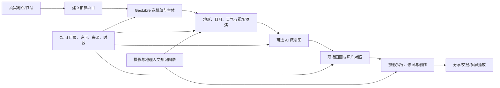

# QuasarFrame 平台功能重设计：以一次拍摄为主线

日期：2026-10-23。状态：**分阶段实施中，不代表以下能力已经全部上线**。首个可发布的完整体验已确定为**风光与星空摄影**；人像、妆造等是同一平台模型的后续扩展。F0 地点配图清查与页面改动见[媒体审计](discovery-media-audit-2026-10-23.md)；GeoLibre 工作台、统一项目和 AIGC 流程仍属后续交付。

## 一、产品定位与当前问题

QuasarFrame 应成为“有证据的摄影决策与创作平台”：用户从真实地点和作品获得灵感，在地图上确定机位、主体、时间和镜头，用地形与天文信息预演构图，在现场对照实时观测，完成拍摄、分析、创作和交付。创作者可在确认权属后提供作品、机位指南、色彩方案或实时频道；手机、电视和数字艺术相框消费同一套内容与权益。

当前问题不是缺少更多独立页面，而是一次拍摄的地点、照片、地图、DEM、日月、天气、模拟图和现场画面没有共用同一份状态和证据。现有 `src/data/locations.ts` 有 10 个硬编码地点，所有 `heroImage/photos` 都是未经地点关联和授权核验的通用 Unsplash 链接，部分图片跨地点复用；`/discover` 直接展示它们。`/scout` 独立挂载 Cesium 地球。牛背山有真实 Copernicus DEM，但目录坐标仍是示意点，与该点 DEM 高程相差约 1412 米，不能当成已经核准的机位。照片分析目前以 EXIF 和人工山脊标记候选为主；知识图谱只有少量编辑建议；相机公开分发默认关闭；AIGC 构图图尚未接入。现状分别见 [地形试点](p2-terrain-pilot.md)和[证据、知识与权益试点](platform-evidence-knowledge-entitlements.md)。

**设计原则**：每张可见照片必须与具体地点或机位建立可核查关联；地图底图、地形高度、实拍、预报、几何模拟和 AI 概念图分别标识；没有来源、许可或精度证据时显示“待核验”，不以更漂亮的内容填充空白。

## 二、用户看到的产品

导航收敛为四个主要空间，跨页面始终保留当前的“拍摄项目”和助手：

| 空间 | 核心任务 | 首屏应看到的内容 |
| --- | --- | --- |
| **探索** | 找真实地点、创作者作品、题材和灵感 | 经核验的实拍卡片；地点、作者、拍摄时间、授权及来源；无可信照片的地点用地图缩略图或无图卡展示 |
| **拍摄工作台** | 选景、机位、构图、时间、镜头和预演 | GeoLibre 地球/地图 + 镜头画幅预览 + 时间轴 + 数据证据栏；保存为同一个拍摄项目 |
| **现场** | 查看授权实时机位、带着计划拍摄、上传/比较照片 | 最新画面采集时间与延迟、现场对照、隐私开关、照片证据与指导 |
| **作品与频道** | 管理作品、创作者内容、订阅与多屏播放 | 获授权作品/频道、许可范围、购买权益、电视/相框投放状态 |

旧 `/discover`、`/scout`、`/location/[id]` 可在迁移后合并或跳转；不保留它们的页面边界作为产品约束。摄影助手是工作台和现场的上下文功能：它读取当前项目、被授权的 Card 与知识关系，给出带出处和不确定性的建议，并能把用户采纳的建议写回项目。首版重点支持日出日落、山体/云海和星空构图：分别联动机位、镜头视场、地形遮挡、日月轨迹、月相、天气时效与可获得的夜空背景数据；云量、透明度和可见星空始终作为条件或预报，不承诺现场效果。手机优先支持规划与现场操作，电视/相框优先展示授权画面、作品和播放清单，不强行复制复杂的机位编辑界面。

一次风光拍摄的主流程：

工作台交互建议：地图点击地点后，侧栏显示**地点证据**；拖动机位和主体后，画幅预览按镜头焦距、传感器、方位和高差同步；时间轴更新日月方位和有效天气预报；“真实照片 / 理论几何 / AI 概念 / 现场观测”四种视图可并排比较，不能在同一画面里混成一种“预报照片”。侧栏采用布局内固定栏或可折叠抽屉，避免悬浮遮挡太阳轨迹等分析内容。人像场景仍复用项目与 Card，额外显示布光、妆容、服装、色彩和室内空间约束。

## 三、统一对象：拍摄项目与证据快照

`ShootingProject` 是产品级聚合，而非把所有资源数据复制进一个巨型表。它保存：用户与协作者、地点/机位/主体、机位坐标及精度、时间窗口、镜头/传感器与画幅、题材/风格意图、当前选择的 Card 版本、隐私级别、照片和生成任务引用、用户确认及历史版本。每次预演产生不可变 `SceneSnapshot`，记录 DEM/3D 模型、地图与天文/天气来源、采集或预报有效时间、几何算法版本、姿态与镜头参数、质量警告、结果哈希。生成概念图另外保存模型、控制图、提示词版本、种子、参考素材授权和同意记录。

用户可以从真实作品“以此为灵感创建项目”，也可以从地图空白处建立项目；项目在手机、网页和现场模式中连续。第三方服务与作者内容使用引用、版本和有效授权，不因被加入项目而变成用户可再分发的资产。公开分享时派生一份去除私有精确坐标和未获许可参考图的分享视图。

所有结果在产品中固定标注四类：**实拍/观测**（含时间和来源）、**理论计算**（含数据精度和误差）、**预报**（含有效期）和**AI 概念**（非真实拍摄或天气预言）。相互矛盾时并列显示，保留用户最终判断。

## 四、真实地点与图片：立即重做内容入口

先停用 `locations.ts` 的通用 Unsplash 图片作为真实景点照片。图片内容和名称偶然相似并不构成同一地点证据。建立 `Place`、`Vantage`、`PhotoAsset` 的编辑链：

1. 地点和机位分别记录来源、WGS84 坐标、坐标方法与误差范围、海拔及其垂直基准、审核人和核验时间。地点中心点不能冒充拍摄机位；牛背山当前目录点必须继续标为示意。
2. 每张实拍图片记录原始文件页/作者、许可版本、署名和改编条件，以及地点关联证据（可信标题/说明、EXIF 或作者陈述、可见地物、编辑核查）。证据不足不能贴“该景点实拍”标签。来自 [Wikimedia Commons](https://commons.wikimedia.org/wiki/Commons:Reusing_content_outside_Wikimedia) 的图片需按**单张文件页**核对许可及署名，不能把整个网站视为统一许可。景区官方图库与用户投稿也分别核对展示、裁剪、商业使用与跨屏分发范围。
3. 展示查询只选 `place_match=verified` 且当前渠道许可有效的资产。没有合格图片就显示地点名称、坐标与地图缩略图，或暂时隐藏该地点推荐位；用户上传但未核验的图只出现在本人工作台。可疑重复图和地点不符图进入编辑审核队列。
4. 用当前 10 个地点做全量清查，按地点建立真实媒体清单和缺口报告；先完成可验证的 2–3 个纵向样板，再补齐其余地点。对外上线门槛是**所有展示为景点实拍的图片 100% 有可复核的地点关联、原始来源和当前展示许可**，而不是强求每个地点都配图。文案中的海拔、交通、观赏季节和“最佳”等断言同时校验或降级为经验建议。

## 五、GeoLibre 地球与 NASA 底图

“选景”采用用户确认的 [opengeos/GeoLibre](https://github.com/opengeos/GeoLibre)。建议按其[私有数据部署说明](https://geolibre.app/self-hosting/)与 QuasarFrame 数据服务放在同一受控域名下，锁定版本，使用[嵌入通信接口](https://geolibre.app/user-guide/embedding/)与拍摄项目同步中心、方向、图层、机位点和主体点；设置精确 origin 白名单与最小命令能力。GeoLibre 的 3D 地球本身由 **CesiumJS 渲染器**提供，2D 主流渲染器是 MapLibre；因此“切换为 GeoLibre”是更换地图工作台和状态集成，而不是完全移除 Cesium。GeoLibre 的[渲染器说明](https://geolibre.app/user-guide/rendering-engines/)也指出 3D 地球、3D Tiles 和地形支持随渲染器而异。

全球概览层首选 NASA GIBS 的 [`BlueMarble_ShadedRelief_Bathymetry`](https://gibs.earthdata.nasa.gov/layer-metadata/v1.0/BlueMarble_ShadedRelief_Bathymetry.json)（或经实机比较后选择另一张 Blue Marble shaded relief 图层），走官方 [GIBS WMTS/XYZ 服务](https://nasa-gibs.github.io/gibs-api-docs/access-basics/)，在 GeoLibre 项目中作为地球影像底图，并保留 NASA 数据集署名、图层名称和时相。NASA 将该层标为 **2004 年 8 月**的 Blue Marble 可视化，绝不能标“实时地球”；它是**视觉底图**，不能拿图像颜色反推精确山脊或视线高程。局部几何仍从已登记 DEM 读取：现有牛背山 Copernicus GLO-30 是试点，其约 30 米格网和 DSM 属性不足以承诺近景、建筑/植被或云海的真实再现。新增地区按 Card 选择已授权的 DEM、正射影像、3D Tiles/点云，并检查坐标系、垂直基准和覆盖范围。NASA 底图、DEM、3D 模型是三个不同的数据角色与授权对象。

**集成验证门槛**：先做只读 GeoLibre 嵌入样板，证明 NASA 底图在全球缩放可用、Cesium 地球和 2D 地图切换可用、项目机位与相机姿态可以双向同步、私有数据不会被公共托管页面或不受控 URL 获取、移动端性能可接受。若嵌入 API 对细粒度摄影镜头控制不足，评估 GeoLibre 扩展包/自托管分支与现有摄影预览画布的同步，不能为了地图迁移削弱现有镜头几何。

## 六、从地形预演到 AIGC 效果图

预演分成两级，用户可直接比较依据：

| 层级 | 计算与输出 | 必须说明的边界 |
| --- | --- | --- |
| **几何预演** | WGS84 机位、姿态、焦距/传感器、DEM/3D、主体与日月位置共同计算画幅、山脊、遮挡、太阳/月亮轨迹；可叠加有时效的天气、能见度、潮汐/雪况等 Card | 地形分辨率、姿态误差、DSM 与地面差异、天气概率；没有现场标定时只给理论构图 |
| **AI 概念图** | 将上述视角渲染为深度、边缘/山脊、语义蒙版等控制条件，结合获许可参考图、风格配方和用户文本，通过 ControlNet 类条件生成或等效模型产出多种可能效果 | 必须标“AI 概念图”；云雾、植被、灯光和人物效果是假设，不能当成现场保证或实拍证据 |

生成任务需排队、限额、可取消，记录模型和控制条件版本、费用与授权。输出可以支持“同机位清晨/黄昏”“同构图电影色/纪实色”等对比，但位置和山脊结构由几何快照约束，不能用生成图反向确认机位。现场校准应以 5–10 个有 WGS84 机位、方向、焦距与照片的真实视角评估，沿用现有牛背山山脊角度中位绝对误差 ≤1° 的试点门槛；在这些数据未获得前继续显示低可信度。没有现成合法参考素材时先提供几何预演，不自动抓网图送模型。

## 七、协议、Card 与知识图谱如何真正进入体验

沿用现有 [GeoNexus 思路的资源卡方案](geonexus-inspired-refactor-plan-2026-10-22.md)，把 `DataCard / MediaCard / CapabilityCard / ModelCard / WorkflowCard` 变成工作台统一调用入口。Card 必填：身份与版本、上游与来源、空间和时间覆盖、分辨率/坐标基准、输入输出、质量与失效方式、可展示/存储/衍生/商用/跨屏/模型输入权限、署名、成本、健康与撤权状态。用户提出“拍今晚的云海”时，平台先查地点 DEM、日月、天气、相机观测和色彩配方 Card，校验覆盖与时效、许可和订阅，再执行能力；缺失时明确说不能估算哪一部分。

适配器按现有能力渐进接入：DEM/天文 → NASA/GIBS 与其他地图服务 → 有许可气象/潮汐/光污染数据 → 照片证据 → 滤镜/LUT/追色 → AIGC/视频。地理资产目录可兼容 [STAC](https://stacspec.org/) 的时空与资产链接，地图与环境能力优先考虑 [OGC API](https://ogcapi.ogc.org/) 或 WMTS/WMS；内部 Card 负责额外的摄影语义、权利、成本、质量和工作流。GeoMCP/MCP 只作为**受控外部接口**，绝不让外部 Agent 绕过私有机位或素材授权。第三方 API 更换时不应迫使用户重建拍摄项目。

摄影 KG 的初始本体围绕实际决策而建：地点—机位—主体—视线—日月/季节；作品—风格流派—摄影师/时代—构图法—色彩方案—滤镜/追色；题材—布光—妆容—服装—镜头；地物—地理—历史事件/人物—文化习俗。每条边带来源、许可、有效期、审核状态与 `fact | observation | inference | recommendation` 类型；历史人文叙述要有可查出处，天气是时效性观测/预报，美学是建议。KG 的第一批产品用例是“为什么推荐这个机位/时间/配色”“按某风格生成可编辑配方”“解释拍摄对象的地理和历史背景”，而不是先追求节点数量或部署复杂图数据库。当前 6 个编辑建议节点不足以支撑事实咨询，需要策展与审核流程。

## 八、现场画面、隐私和订阅

固定高空相机与用户移动机位统一为 `CameraCard` 和按时间生成的 `ObservationCard`，但两种权属流程分开：固定相机由源方确认二次分发、截图、转码、AI 衍生、商用、跨屏、缓存与撤权范围；移动用户按每次投稿或会话选择私有对照/公开分享/订阅频道。当前 `AUTHORIZED_FEED_IDS` 默认关闭的来源继续保持关闭，直到源级权利齐全。

每帧或片段区分采集、接收、处理和展示时间；超过源级可接受画面年龄就显示“延迟画面”或停止进入实时频道，不能用页面刷新时间伪装实时。原始高精度坐标、可识别人脸/车牌及相机私有元数据默认不进入公共频道；公开的派生内容先做遮挡、位置模糊或延迟，保存审计与撤权通道。用户原图、视频和私有机位默认仅在受控存储和自托管处理链中使用。

已确认的第三方模型策略是**逐次用户同意**。每次外传前展示将发送的文件/片段、是否包含坐标/EXIF、服务商、用途、保存期限和估计费用；默认剥离 EXIF 与精确坐标，按需裁剪或模糊敏感区域，只发完成本次任务需要的内容，记录单次同意及模型服务返回的删除/保留信息。一次同意不覆盖以后上传，不允许默认用于训练。许可、用户同意、隐私过滤和订阅权益都通过后才可生成风格化画面；撤权后停止新分发并清理可控缓存。正式运营前还需核对服务商条款和实际数据流。

收费先区分**内容权**（作品/频道）、**能力权**（预演、AI、追色调用）与**终端权**（网页、手机、电视、相框）三层，再试点单一订阅或单次能力，不把购买某张作品推断成可训练、转售或无限跨屏播放。创作者上架时提交原始作品与权属证明、定价/分成、许可版本；审核通过后才能进入公共探索或频道。硬件型号未定时先做电视/相框软件播放器和设备能力档案，验证横竖屏、刷新频率、离线缓存、撤权和订阅清单，再选硬件 SKU。

## 九、实施包与验收门槛

工期仅是 1–2 名熟悉项目开发者的排期参考，不含第三方授权、现场真值采集或大规模模型训练。

| 包 | 交付物 | 进入下一包的验收条件 | 粗估 |
| --- | --- | --- | --- |
| **F0 内容止损与统一设计** | 移除未核验的景点实拍展示；建立 10 地点媒体审计表、卡片状态与无图降级；拍摄项目原型和页面信息架构 | 对外“景点实拍”无错配或无来源图片；每个地点知道缺什么证据；原有授权与私有内容不回退 | 1 周 |
| **F1 GeoLibre 工作台** | 锁定/自托管 GeoLibre；NASA 全球概览层；地图机位、主体和拍摄项目同步；把现有地形/天文结果放进同一工作台 | 2D/3D、底图、项目保存/恢复、手机操作、私有数据边界通过实机验证；无 DEM 时明确降级 | 2–3 周 |
| **F2 真实场景与预演** | 2–3 个有真实照片、合法媒体、已核机位的风光/星空纵向样板；多 DEM/3D 卡、镜头几何、日月/月相与夜景条件；AI 概念图任务化试点 | 实拍/理论/预报/AI 标识清楚；白天与夜间几何真值报告可审阅；生成所用参考素材和第三方外传均有许可与同意 | 3–5 周，现场数据另计 |
| **F3 摄影助手与 KG** | 风光/星空所需的领域本体、编辑审核、来源检索、风格/构图/色彩配方；助手可调用已授权 Card 并把建议写回项目。布光/妆容等先定扩展关系，不作为首版内容库 | 抽样问答能回溯来源；事实与审美建议不混淆；私有机位不会通过问答泄漏 | 2–4 周 |
| **F4 现场与供给闭环** | 授权摄像头和用户移动机位、画面新鲜度、隐私过滤、逐次同意的风格化、创作者上架及软件端订阅试点 | 撤权停止新分发；过期画面不称实时；跨屏权益、同意和账目可追溯；至少一个来源签完必要授权 | 4–6 周，依授权而定 |

可量化发布门槛：公开景点实拍的**地点匹配/来源/渠道许可完整率 100%**；10 个现有地点全部完成审计，未达标者无图或不推荐；GeoLibre 全球底图和项目同步通过桌面/手机烟测；地形结果能追溯 DEM 与机位版本，未通过实测前不得标“精确预报”；每张 AI 图有模型/输入/授权/生成标识；相机源有采集时间、授权和源级新鲜度阈值；未经同意没有第三方原始影像出口；KG 事实回答有出处。之后再以用户完成一次拍摄计划的成功率、现场建议采纳率与付费留存评估产品价值。

## 十、仍需产品决定的边界

已明确：GeoLibre 指 opengeos/GeoLibre；第三方模型可在**用户逐次同意**下使用；首发题材为**风光与星空**。尚待确定但不阻碍 F0/F1：第一批可提供真值照片与机位的 2–3 个地点；相机源是否允许公开截图/视频转码/AI 衍生及各终端分发；每个来源可接受的画面更新延迟；AI 参考素材与模型服务的商业许可；首个付费产品究竟是摄影助手能力、创作者内容，还是实时频道。先以**风光/星空拍摄工作台 + 经核验地点 + 私有用户照片**做端到端闭环，其他题材在同一项目模型上扩展。

## 实施进度：2026-10-24

F0 已完成首轮内容清理。F1 已落地拍摄工作台基础版：自托管 GeoLibre 2.5.0、NASA 概览、球面/2D 投影、项目保存恢复、地形/天文共用参数，以及 NASA 资源 Card。自动测试 36 项通过，桌面与 390px 视口烟测完成。详见 [F1 实现与部署记录](geolibre-workspace.md)。

F1 尚未全部验收：完整 Cesium 三维渲染器及姿态控制、嵌入构建裁剪、手机硬件性能、照片校准共享项目草稿仍待后续；F2–F4 的生成、KG 助手与订阅闭环不能算作本轮完成。下一步先补齐 F1 三维与校准集成，再进入 F2 的几何控制图和逐次同意的 AI 概念图任务。
