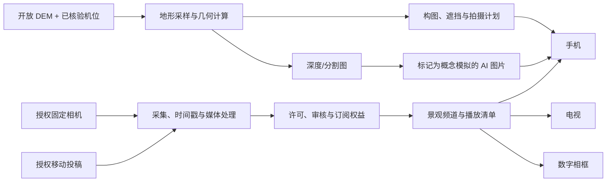

# 真实地形、AI 构图模拟与多屏订阅方案

更新：2026-10-18。本文承接[架构完成度评估](architecture-assessment-2026-10-18.md)和[摄影地理工具进度](photography-tools-progress.md)。产品主线调整为「摄影者的选景与拍摄助手 + 经授权的实景内容订阅」；手机、电视、数字艺术相框是同一服务的不同终端，实体相框是可选硬件产品。

## 判断与已核实事实

可以从免费开放的约 30 米全球高程数据开始，做**远景山脊、地平线、日月与主体方位、视线遮挡的近似估算**。它不能单独保证近景岩石、树木、建筑、道路和实际天气的照片级还原。基于真实地形生成的 AI 画面只能称为「概念模拟」，不能称为预测照片或实况。

当前代码的 Cesium 地球使用椭球面，`src/hooks/useCesium.ts` 没有接入地形源；`src/components/camera/CameraSimulator.tsx` 用正弦函数生成平面山形。地点资料仅保留 0.01° 坐标，坐标系和海拔基准未核验（`src/data/location-provenance.ts`）；这样的地点级坐标可能偏离精确机位数百米，先接 DEM 也无法给出可靠构图。

已检查项目内牛背山示意点 `[102.30, 29.88]` 所在的 Copernicus GLO-30 云优化 GeoTIFF 瓦片 `N29E102`：公开对象的 HTTP 响应为 `200 OK`，大小 43,080,749 字节并支持 Range 请求。这证明试点数据可获取；**尚未下载、裁切、接入页面或进行现场精度验收**。对象地址：`https://copernicus-dem-30m.s3.amazonaws.com/Copernicus_DSM_COG_10_N29_00_E102_00_DEM/Copernicus_DSM_COG_10_N29_00_E102_00_DEM.tif`。文件名中的 `10` 是 1 角秒级产品标识，不是 10 米分辨率。[AWS 数据集目录](https://registry.opendata.aws/copernicus-dem/)。

| 候选数据 | 适用性与限制 | 试点用途 |
| --- | --- | --- |
| [Copernicus DEM GLO-30](https://dataspace.copernicus.eu/explore-data/data-collections/copernicus-contributing-missions/collections-description/COP-DEM) | 全球约 30 米，免费许可；为包含树木/建筑的 DSM，主要源自 2011–2015 年影像；水平 WGS84，高程 EGM2008。官方全球绝对精度指标不是每个峡谷或机位的局部保证；公开传播和改编有来源署名要求。 | 主 DEM；下载试点 ROI，并记录版本、填补掩膜、来源说明。 |
| [USGS SRTM 1 Arc-Second Global](https://www.usgs.gov/centers/eros/science/usgs-eros-archive-digital-elevation-shuttle-radar-topography-mission-srtm-1/) | 约 30 米，公开分发；观测年代为 2000 年，部分格网仍可能有空洞，高程基准 EGM96。须选 1 Arc-Second Global，不要混成全球 3 角秒产品。 | 对照异常坡面及空洞，不能直接与 EGM2008 高程混算。 |
| [JAXA ALOS AW3D30](https://www.eorc.jaxa.jp/ALOS/en/dataset/aw3d30/aw3d30_e) | 约 30 米 DSM，注册和使用条款需逐项核对；精度同样需按地点验证。 | 主 DEM 有异常时的独立交叉检查。 |

30 米是**采样间距**，不是每个地物的定位误差，也不是照片细节分辨率。10 米高程差在 1 千米距离约对应 0.57° 仰角变化；近距离遮挡尤其敏感。界面须显示数据来源、分辨率、时间、误差带和「该分析不覆盖近景小地物」提示。国内地图底图若使用其他坐标基准，必须显式转换和核验，不能把不同坐标直接叠加。

## 三层产品能力

### 第一层：可信地理与构图计算

以一个可到达、能现场复核的牛背山机位为样板：分别记录拍摄机位、主体、固定摄像头的位置；每条记录含经纬度、坐标基准、海拔基准、地面以上相机高度、朝向/俯仰/横滚、精度、来源与核验日期。手机 GPS 点位只作为候选，允许用户按实测位置校正。

将 GLO-30 原始 COG 保留在数据存储，服务器裁切机位周围的关注区域和多级分辨率，生成可供 Cesium/Three 显示的地形；同时保持独立高程采样服务，计算 360° 地平线、方位剖面、机位—主体视线及日月被地形遮挡的时刻。渲染结果与数值分析必须引用同一 DEM 版本和统一高程基准。Cesium 可用[自托管地形提供器](https://cesium.com/learn/cesiumjs/ref-doc/CesiumTerrainProvider.html)；避免让浏览器直接下载整幅 43 MB 栅格。

给出焦距/传感器/画幅下的构图框和地形轮廓，先通过实地全景照片与已知山脊点做配准。验收先看重复测量的角度误差、无数据区域和用户能否识别「估算」；通过试点再定大范围 SLA，不先承诺像素级重合。

### 第二层：可执行拍摄计划与受约束的 AI 模拟

把机位、主体、时间、镜头、太阳/月亮、云量/能见度的**数据来源与发布时间**放入同一拍摄方案；天气/道路未接入时显示未知，不能生成成功概率。加入安全到达、步行时间、可停车位置、备选机位、离线计划和现场照片回传；路线与可达性由合规地图/道路源提供，不能从直线距离推导。

AI 生成链路：锁定第一层计算的相机姿态、视场和山脊轮廓 → 渲染深度、法线、语义分割与天空掩膜 → 将这些条件交给 ControlNet 类模型和生成模型 → 输出带「AI 概念模拟」标记的结果。ControlNet 支持深度等结构条件，**不能保证生成的云、光、树或建筑会真实出现**。[ControlNet 技术说明](https://huggingface.co/docs/diffusers/main/en/using-diffusers/controlnet)。优先用示意贴图做低成本预览；高成本图像生成按需触发、缓存且限额。记录模型/权重版本、提示词、DEM 版本、天气来源、参考图许可，公开前核对模型及素材的商业使用条款。真实地形计算结果应可单独查看，不被生成图覆盖。

### 第三层：机位资源订阅与多屏服务

统一内容对象：`Source`（固定摄像头、摄影者移动投稿、授权作品）、`Observation`（采集时间、接收时间、位置/朝向/准确度、新鲜度）、`Asset`（视频、快照、图片及衍生版本）、`License`（展示、缓存、转码、跨终端、收费、撤回）、`Channel`（地点/主题策展）、`Entitlement`（用户与设备权益）、`Device/Playback`（能力、清单、播放回执）。摄像头源健康和内容权益先于收费订阅。

固定高空相机可形成持续观测与实时场景频道；移动摄影者提供带拍摄时间、机位与许可的现场照片/短视频，默认是**投稿与近实时观测**，不等同于持续直播。移动机位的精确位置和个人信息需由贡献者主动选择公开粒度，建立审核、撤回、署名/分成规则。现有真实摄像头的**二次分发授权、允许播放的终端、可接受采集到展示延迟**尚未定，先仅按现有接入范围使用；所有用户端必须显示采集时间并按待确定阈值标记过期画面。

首个软件端建议使用响应式 Web/PWA 做摄影助手和手机浏览；电视先试验浏览器/电视 Web 播放器的授权频道及遥控操作；数字艺术相框在终端型号、解码能力、离线/远程更新能力确定后再产品化。三者复用权益、内容清单和媒体变体，播放器按横竖屏、分辨率、码流能力分别适配。固定摄像头流应经独立采集/转码/缓存/CDN 管线，而不是由每个屏幕通过 Next.js 代理重复拉取上游。实景快照可先于直播试点，以验证新鲜度与授权边界。订阅成本要按源费用、转码/存储、CDN 出口、AI 推理、审核与创作者分成核算；开放 DEM 不等于免费运营。

## 建议的下一步与交付门槛

1. **一处 DEM 技术试点，约 1–2 周**：取得 `N29E102` 瓦片，裁切牛背山候选机位周边，做地形剖面/地平线/视线分析和页面预览；核对现场精确机位及若干已知山脊。产出误差记录、无数据处理、来源署名和可重复脚本。暂以 2 千米外可辨识山脊的中位仰角误差 ≤1° 作为试验门槛，最终阈值按现场样本和使用场景调整；若未达到，标明低可信度并寻找有许可的局部高精度数据。
2. **摄影助手闭环，约 2–4 周**：一个「机位—主体—日期—镜头」方案从地图选点到构图框、地形遮挡、出行与现场对照可保存和跨端读取。上线前校正现有示意地点的坐标与海拔；天气、路网等外部服务逐个接入并标注时效。验收 5–10 个现场照片或公开可核验视角，由人工标注山脊与主体的角度差。
3. **AI 概念模拟试验，约 2–3 周，可与第 2 步部分并行**：只针对试点机位；几何遮挡和焦距参数由计算结果控制。评估用户是否把 AI 图误认成预测或实拍、是否保留轮廓、单图延迟与成本；不过关不接入拍摄决策主流程。
4. **授权内容与多屏试点，约 3–6 周，依赖授权确认**：一台已授权固定相机、一组明确许可的移动投稿、一个手机端和一个电视端；相框用浏览器模拟器验证清单/回执。验收撤权、断流/过期、离线、支付权益与多端播放，再决定硬件型号与供应链。

这些时间是小团队的粗估，范围随数据获取、现场核验、模型选择、授权谈判与终端能力调整。最先需要确认的产品决定是：试点机位和实测参考照片、摄像头授权矩阵、可接受画面延迟及首批收费对象（摄影规划工具还是授权景观频道）。地形试点和软件端可先推进，不必等待相框选型。
